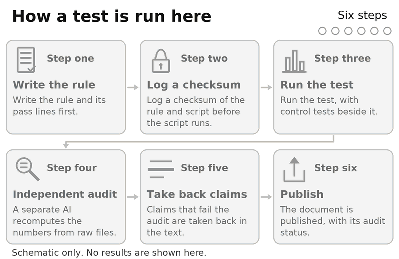
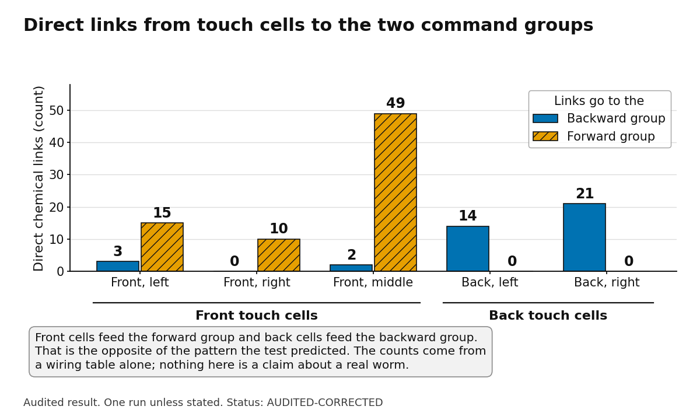
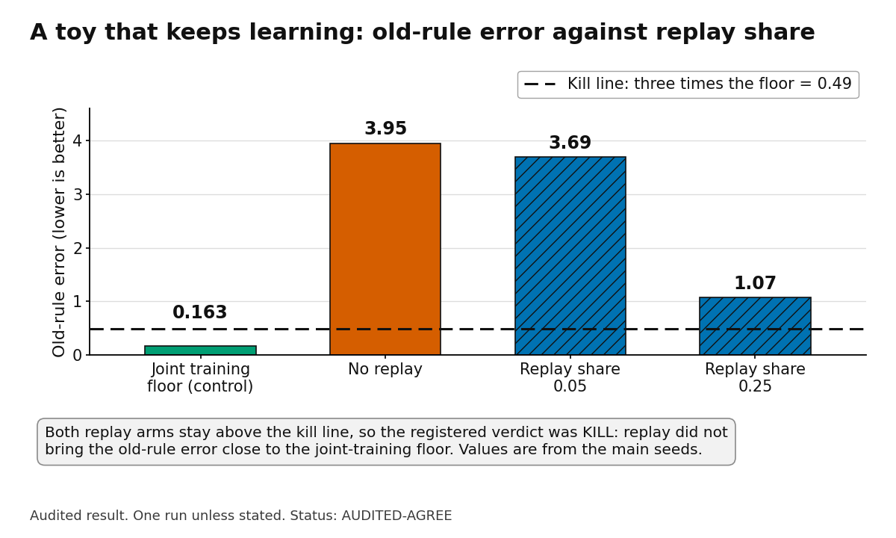
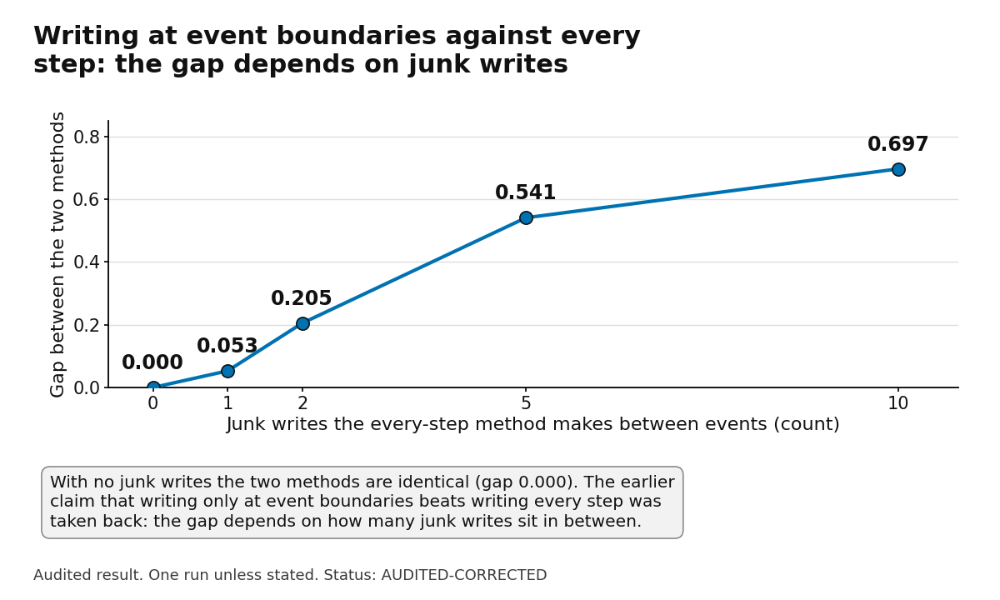
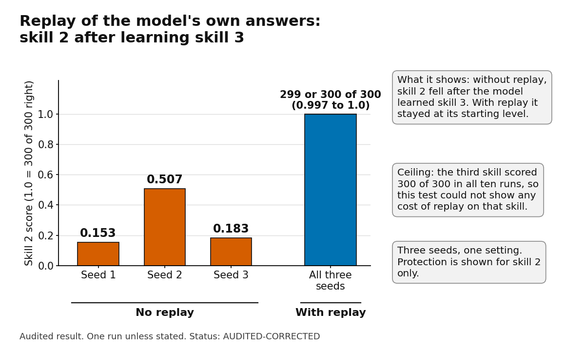
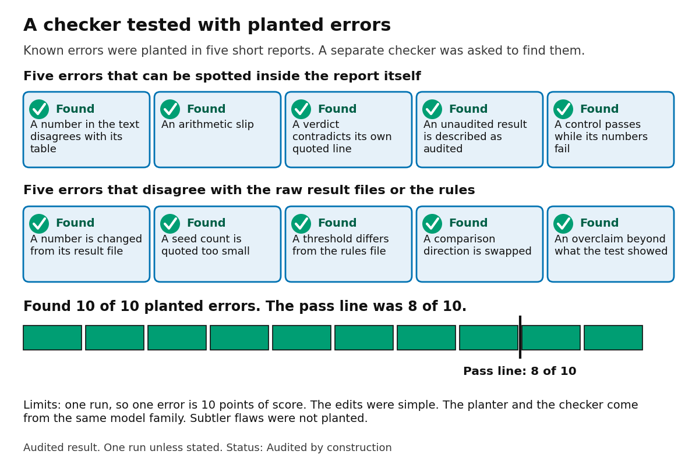

# 34. What we tested on 12 November and what the audits took back

## What this is

Snapshot dated 12 November 2026. Every test here had a written rule with fixed pass and kill lines. Each rule was registered with a checksum before the script it governed ran, as far as the audits could check. A separate AI pass, which we call the skeptic, then recomputed the numbers from the raw files, checked the rule, and wrote an audit note.

Only audited results are reported. Where an audit took a claim back, this text says so and gives the reason. Tests that do not yet have an audit note are left out, and no numbers from them appear.

**Labels.** **FACT (audited)** means we measured it and an audit recomputed it. **GUESS** means our reasoning, not tested. **INFERENCE** means a conclusion drawn from audited facts. It was not tested directly.

**Audit status words**, as the audit notes use them. **AUDITED-AGREE** means the audit reproduced the numbers and agrees with the verdict. **AUDITED-CORRECTED** means the numbers reproduce, but some wording or readings changed. **AUDITED-INVALID** means the audit says the test cannot answer the question it was written for.

*Figure 34.1.* How each test here is run: the rule and its pass lines are written first, a checksum is logged before the script runs, the test runs with control tests, an independent AI audit recomputes the numbers from the raw files, claims that fail are taken back in the text, and the document is published with its audit status. The checksum order is confirmed only as far as the audits could check; each audit is one pass by a separate AI reviewer, and nothing here has been peer reviewed. The diagram shows no results.

## Summary

**FACT (audited).** The table lists each test in this document.

| Test | What we asked | What the audit says | Status and how far to trust it |
|---|---|---|---|
| BRAIN-1 | Does our own neuron and timing-rule code match textbook behaviour? | Numbers reproduce. Four numeric checks passed, one failed by a small margin | AUDITED-CORRECTED; implementation checks only |
| BRAIN-2 | Does the worm touch wiring point the touch direction the right way? | The test could only ever return KILL | AUDITED-INVALID |
| BRAIN-3 | Same question, steady-state linear model on the wiring alone | Chemical wiring is reversed beyond chance; the cause is the wiring | AUDITED-CORRECTED; no claim about a real worm |
| STREAM-LEARN-2 | Can a toy keep learning new rules while replaying old examples? | KILL stands; replay stays far above a joint-training floor | AUDITED-AGREE |
| FLIP-T1 | Can a memory matrix keep events and their order? | UNCLEAR stands; both headline wins depend on design choices | AUDITED-CORRECTED |
| FLIP-T3 | Does replay protect old rules in a simple learner? | KILL stands under its lines; replay effect short of the target | AUDITED-CORRECTED |
| NEURO-19 | Does replaying the model's own answers keep skill 1 while it learns skill 2? | Core effect reproduces; one seed per replay arm | AUDITED-CORRECTED |
| NEURO-20 | Does the same hold for a third skill? | Holds for skill 2 in the registered metric; seven corrections | AUDITED-CORRECTED |
| PLANT-1 | Does our checker catch planted errors? | 10 of 10 planted errors found; one run | Audited by construction |

## 1. A unit test of our own neuron and synapse simulator

**FACT (audited).** We wrote a simple spiking neuron, a leaky integrate-and-fire model. We also wrote a textbook detailed neuron, the Hodgkin-Huxley model, and a timing rule for synapses. Under that rule a connection grows or shrinks depending on whether the input spike came just before or just after the output spike. Each piece was checked against a known behaviour with a fixed band.

**FACT (audited).** The registered checks were five numeric checks, one descriptive onset check, and two checks left out of the verdict. The verdict was PARTIAL. Four numeric checks passed and one failed.

**FACT (audited).** What passed. The simple neuron's firing rate matched its closed-form formula to machine precision. A control that changed the membrane time constant by 8 percent was detected, so the test can see a small error.

**FACT (audited).** What also passed. The detailed neuron rested at about minus 65 millivolts. It did not fire when its sodium conductance was set to zero. The timing rule matched its formula at all twelve time lags.

**FACT (audited).** What failed. The peak of the first spike. The registered band was plus 30 to plus 40 millivolts. Finer integration gave a peak of about plus 40.3 millivolts, and the coarser first run gave about plus 40.5. Both sit just above the upper edge, so the failure does not depend on the integration method.

**FACT (audited).** The upper edge had been 45 millivolts. An earlier run had already measured a peak just above 40. The edge was then lowered to 40, and the change was not recorded in the registration note. The audit calls this a post-result change.

**FACT (audited).** The audit could not find a readable source that confirms plus 40 millivolts for this parameter set.

**INFERENCE.** The band is probably too tight, not the model wrong. The audit says not to move the line now, and to record the peak as a band question.

**FACT (audited).** The onset band was also changed after results were seen, and its firing rule changed with it. The check is now descriptive only and does not count toward the verdict.

**FACT (audited).** A spike-width check that had passed in an earlier run was left out of the verdict after it was seen to pass. The audit calls this a dropped passing line.

**FACT (audited).** The script fixed one input so that a PASS was impossible. The audit says this matches the rules, but it means no outcome of this run could have been a PASS.

**FACT (audited).** The negative control that flips the sign of the timing rule fails at every lag by exactly 200 percent, by construction. It says nothing. The audit proposes a control that swaps the two time constants instead.

**INFERENCE.** The lower onset band may describe a single spike crossing a threshold, not repeated firing. The audit reached this reading from its scan rows. It is not confirmed against a source.

**FACT (audited), corrected reading.** These checks show that the code does what its formulas say. They do not show that a spiking neuron or a timing rule behaves like a brain. Irregularity of firing was not tested, so no claim is made about it.

## 2. The worm touch-circuit tests

**FACT (audited).** The question. A worm senses touch at its front and at its back. The registered prediction is that front touch should drive the backward group of command cells, and back touch the forward group. We tested whether a wiring table of the worm's nerve cells, read with simple models, points the same way.

**FACT (audited).** Nothing here is a claim about a real worm, its behaviour, or males of the species. The models use the wiring table alone. No signal strengths were measured.

### The first tries that could not be graded

**FACT (audited).** The first data check stopped as ungradeable. Only 5 of 9 cell names matched exactly, and the rules call that a stop.

**FACT (audited).** Twenty-four seconds after the stop was logged, a registered addendum counted left and right class names as found, and the test went on. The audit calls this a deviation. A triggered stop was overridden in the same session without the decision the stop required. The addendum was filed before any model code ran, so the order was right, but the authority was not.

**FACT (audited).** The second data try was built on 393 neurons, not the registered 302. A check on that set still printed PASS, which the audit calls a wrong verdict line. A later addendum fixed the count to 302 and transposed the model's matrix. The rules required a new numbered file for a formula change. The change was filed as an addendum instead.

**FACT (audited).** Two other addenda were empty files. The audit voids them.

**INFERENCE.** Neither early try can be graded as registered. They tell us about the process, not about the worm.

### The ceiling effect

**FACT (audited).** The score was the share of 200 small random weight changes that gave the right sign. For the real wiring the share was 1.0. About 17 to 19 in 100 of the random-wiring nulls also reached 1.0.

**FACT (audited).** The 95th and 99th percentiles of the nulls were both 1.0. A PASS needed a value above 1.0, which cannot happen. A KILL fired at any value at or below 1.0, which always happens. So the verdict was KILL whatever the data.

**FACT (audited).** The audit calls this a property of the test, not of the worm. It marks the test AUDITED-INVALID as a test of touch direction.

### The gap-junction problem

**FACT (audited).** Gap junctions are electrical links that pass signal both ways. The setting the pilot chose made the model almost entirely gap junction.

**FACT (audited).** With chemical wiring alone, the sign was the opposite of the prediction. This held at all five decay settings the audit checked.

**FACT (audited).** The pilot chose the setting that maximised the score, so it chose the gap regime. The audit says the pass came from the gap term, not from the direction of the chemical wiring.

**FACT (audited).** A probe that flipped the direction of the chemical matrix gave the same sign on the real wiring. The score does not change with the direction it is meant to measure.

### The steady-state model (BRAIN-3)

**FACT (audited).** The next test, BRAIN-3, used a steady-state linear model. It asks what the network settles to, given the wiring. It had three variants: chemical wiring only, gap junctions only, and both together. Chemical wiring only is reported first.

**FACT (audited).** The chemical-only variant came out reversed. Its score was negative at every decay setting from 0.05 to 0.95, and in every setup the audit tried.

**FACT (audited).** Only 3 of 1000 random wiring draws reached the real value or lower, a p of 0.003. The audit calls this reversed beyond chance.

**FACT (audited).** Shuffling the counts on the real links gave a median close to the real value. The audit reads this as showing that the reversal comes from which links exist and which way they run, not from the weights.

**FACT (audited).** The raw direct counts already point the same way. Here are the direct chemical links, as the audit gives them.

| Touch cell | Direct links to the backward group | Direct links to the forward group |
|---|---|---|
| Front, left | 3 | 15 |
| Front, right | 0 | 10 |
| Front, middle | 2 | 49 |
| Back, left | 14 | 0 |
| Back, right | 21 | 0 |

**FACT (audited).** Read by eye, the raw counts show the same direction the model shows. A plain reading of the table would have shown the problem before any model was fitted.

*Figure 34.2.* Direct chemical links from five touch cells to two groups of command cells, from a wiring table (audited, status AUDITED-CORRECTED). Front cells link mostly to the forward group (15, 10 and 49 links, against 3, 0 and 2 to the backward group) and back cells only to the backward group (14 and 21 links, against 0). This is the opposite of the registered prediction, and it was visible in the raw counts before any model was fitted. It is a statement about the wiring table, not about a real worm.

**FACT (audited).** Two probes ruled out two suspected causes. One changed the set of nodes (302 neurons, and a version with 473 nodes). The other changed how scores were normalised. The sign stayed negative in every case. The lab's first guess that normalisation caused the sign is taken back.

**FACT (audited).** The verdict is KILL under the registered lines. The gap-only variant gave a p of 0.065, and the combined variant 0.068, both just above the 5 percent line. A PASS was out of reach. The audit says a KILL hides the fact that the chemical result is reversed, not just unsupported. Status: AUDITED-CORRECTED.

**FACT (audited).** Wording taken back. The phrase "near miss" for the gap-only variant. The claim that a steady-state linear model cannot carry a sign, which the audit calls an overreach. The claim that a human anatomist would make the same call, which is unsupported. The claim that verdicts depend on normalisation, which is untested and contradicted.

**INFERENCE.** The wrong sign comes from the wiring itself, not from our scoring.

**GUESS.** A better test would score the chemical wiring alone, with its settings fixed in advance, and would check that flipping the direction changes the score. It would need its own registration. It has not been run.

## 3. Weights that keep changing, with replay of old examples on a toy (STREAM-LEARN-2)

**FACT (audited).** "Never frozen" means the weights keep changing as new examples arrive, with no separate training stage. Here a small linear model saw four rules one after another. Each rule had its own examples.

**FACT (audited).** Replay means mixing stored old examples into the training slots. The replay share is the fraction of slots drawn from stored examples. The test used shares of 0.05 and 0.25. Each rule stored 64 examples once it was finished.

**FACT (audited).** The joint floor is a control. It trains one copy of the same model on all four rules at once, with the same starting point, the same learning rate and the same number of steps. It is the best that the same number of steps can reach.

**FACT (audited).** The kill line was that old-rule error must stay above three times the joint floor at both replay shares. It did.

**FACT (audited).** On the main seeds the joint floor's average error was 0.163. The old-rule error was 3.69 at replay share 0.05 and 1.07 at 0.25. Both are above 0.49, which is three times the floor. Without replay it was 3.95. The verdict is KILL.

*Figure 34.3.* Old-rule error of a small linear toy that learned four rules one after another (main seeds, status AUDITED-AGREE). Replay lowers the error (3.95 with none, 3.69 at a share of 0.05, 1.07 at 0.25) but both replay arms stay above the kill line of 0.49, three times the joint-training floor of 0.163, so the registered verdict was KILL. The floor control passed narrowly (0.163 against a limit of 0.198). The scale is linear and starts at zero.

**FACT (audited).** Controls. The positive control passed narrowly, at 0.163 against a limit of 0.198. Per-seed floors ranged from 0.09 to 0.43, so the margin is narrow by nature. The negative control and the separation check also passed.

**FACT (audited).** The pilot pass was thin. The pilot gave 0.191 against a line of 0.207. A learning rate of 0.03 at the same step count gave 0.389. So the chosen setting sits near a cliff.

**FACT (audited).** Robustness probe. The audit ran a labelled extra, not registered, on 40 new seeds, testing only the 0.25 replay share against the floor. At the registered setting the old-rule error was 0.989 against a floor of 0.185, and 38 of 40 seeds were above three times the floor. With a longer run and a smaller step, the error was 0.270 against a floor of 0.031, and 39 of 40 seeds were above three times. The probe did not test the 0.05 share, so it does not re-derive the full verdict.

**FACT (audited).** Status: AUDITED-AGREE. Every rule was followed, every number reproduces, and the probe agrees with the registered reading.

**GUESS.** On this toy, the old rules and the new rule compete for the same weights. Replay moves the balance between them but does not remove the conflict.

**GUESS.** The next test would sweep the replay share at 0.5 and 1.0, with more stored examples. It is not registered.

## 4. The flip tests: what was taken back

**FACT (audited).** Two flip tests were audited. Both reproduce, and both are reported as their audits leave them. Neither is called invalid.

### FLIP-T1, event writing into a matrix

**FACT (audited).** The question was whether a memory matrix can recall events, and their order, when they are written in. The verdict is UNCLEAR, and the audit agrees that UNCLEAR is fair.

**FACT (audited).** Taken back: the claim that writing only at event boundaries beats writing every step. The gap depends on how many junk writes the per-step arm makes between events. With 0, 1, 2, 5 and 10 junk writes the gap was 0.000, 0.053, 0.205, 0.541 and 0.697. With no junk writes the two arms are identical.

*Figure 34.4.* Gap between writing a memory matrix at event boundaries only and writing at every step, against the number of junk writes the every-step method makes between events (0, 1, 2, 5 and 10 junk writes: 0.000, 0.053, 0.205, 0.541, 0.697; status AUDITED-CORRECTED, overall verdict UNCLEAR). With no junk writes the two methods are identical, so the audit took back the claim that boundary writing beats every-step writing. The document gives no unit for the gap.

**FACT (audited).** Taken back: the win over a list of the same memory size. The list was stored at full precision. Stored at half precision, the same memory holds 64 pairs, with recall of 0.32, a tie with the matrix at 0.332.

**FACT (audited).** Taken back: the CPU time. The report said about a minute, and the run took 2.5 seconds.

**FACT (audited).** Order was only weakly recovered. The oldest 50 of 200 events scored 0.551. The 0.60 threshold for order was a guess, and the audit says the matrix does not keep order in any useful sense yet.

**FACT (audited).** Thirty-two events in a 64-number key is almost trivial to recall, so the 32-event line mostly tested the filler count.

**INFERENCE.** This test measured a design choice more than the idea. Filler count and number precision decided both headline wins.

### FLIP-T3, replay in a stream of rules

**FACT (audited).** The verdict is KILL under the registered lines. The linear learner and a small network with 16 hidden units were both tested. The network's gain check was 0.064 against a line of 0.10, which the audit says is about 1.5 standard errors below the line, so it is not firm.

**FACT (audited).** Taken back: "unreachable by any learner". The audit supports only "unreachable for linear learners on this data layout". For the small network the argument does not follow.

**FACT (audited).** Taken back: "replay does the work". Replay cut the damage to old examples by 1.7 times for the linear learner and 1.6 times for the network. The registered target was 2 times, so the target was not reached.

**FACT (audited).** Facts the report left out. With no replay the linear learner ended with error on old examples (0.309) above the error of predicting zero (0.257).

**FACT (audited).** Facts the report left out. On the new rule, the frozen model was better than every updated arm. Frozen error was 0.016. Updated arms ranged from 0.027 with the larger replay share to 0.107 with no replay. Learning the first three rules made the new rule worse.

**FACT (audited).** Taken back: the word "invalid" for this test. The audit says calling it invalid after a KILL, without an audit, looked like a change of verdict. It should be reported as a KILL with the caveats.

**FACT (audited).** The audit also says the 5 percent line on a near-zero baseline is fragile, and that absolute error bounds would be easier to read. Replay anchors came only from the first rule, so the test never checked replay of the later rules. The learning rates were chosen without a pilot.

## 5. Replay of the model's own answers while learning a third skill

### The two-skill toy (NEURO-19)

**FACT (audited).** Replaying the model's own earlier answers kept skill 1 near its old level. Skill 1 scored 0.963 with replay and 0.567 and 0.640 without it, on two seeds. Skill 2 stayed at 0.993 to 1.000.

**FACT (audited).** Taken back: "needs no labels". The loss needs no label, but the stored inputs carry the true row digit as part of their text. Scoring also showed the true row to the model.

**FACT (audited).** Taken back: the reading that gentle learning rates protect skill 1. Lower rates did worse on skill 1. Damage appeared at every rate tested and was not steady across them. The cause is not known.

**FACT (audited).** Each replay arm was one seed, so the order among the replay arms is noise. One arm was stopped by a memory limit after its verdict was logged, so it is reported from its log only.

**FACT (audited).** Scoring was teacher-forced, meaning the true row was in view when the column was scored. This is the same for every arm, so the comparison holds, but the absolute numbers are higher than free running would give.

### The third skill (NEURO-20)

**FACT (audited).** The third skill was easy. It scored 300 of 300 in all ten runs. The test could not fail on it, and it could not show a cost of replay.

**FACT (audited).** The replay target was the model's whole output distribution at the two answer positions, taken from the starting state. The stored inputs were the first 64 training examples of each old skill, with the model's own sampled row digit in context.

**FACT (audited).** Without replay, skill 2 fell to 0.153, 0.507 and 0.183 across the three seeds. With replay it stayed at its starting level, 299 or 300 of 300. The replay arm matched the arm trained on true labels to within 0.001.

*Figure 34.5.* Skill 2 after the model learned a third skill (status AUDITED-CORRECTED). Without replay it fell to 0.153, 0.507 and 0.183 in the three seeds; with replay of the model's own earlier answers it stayed at its starting level, 299 or 300 of 300. The third skill scored 300 of 300 in all ten runs, so this test could not show any cost of replay on that skill; protection is shown for skill 2 only, with three seeds and one setting.

**FACT (audited).** The gap between no replay and replay on skill 2 was about 0.70. That is about twice the registered band.

**FACT (audited).** Seven corrections. The audit's numbered list is given here in plain words.

1. The name. "Replay of sampled answers" is soft self-distillation. The model is pulled toward its own full output distribution. No arm used the sampled digits as hard targets, so the effect cannot be credited to the samples.
2. The stored digits. The stored digits equal the true digit in 127 or 128 of 128 entries in each seed. The stored inputs encode the answer. "No label" is true of the loss only.
3. The caveat. The "97 to 100 percent right" caveat is about the sampled digits. The actual target is a whole distribution. For skill 2, about 63 percent of the target's mass sits off the answer digits.
4. Protection. It is shown for skill 2 only, and only in the registered metric. For skill 1 the result is non-harm only.
5. Scoring. The old skills were scored with the inherited four-way digit scoring. Free running, skill 1 starts at 0.89 and skill 2 at 0.25. Replay keeps those values. It does not turn them into free-running skills. Only skill 3 is a free key press.
6. Ceiling. A third skill at 300 of 300 cannot show a learning cost. The margin of 0.05 is far from the drop replay causes, so the main contrast could fail, and did fail for the no-replay arm. For any claim about cost, the test has a ceiling.
7. Overreach. The claim of adding skills from stored prompts and no stored labels was shown only for one easy third skill, three seeds, one setting, 64 prompts, and about 254 MB of stored references per run. Four or more skills, a harder skill, an error-rich store and a drifting model were not tested.

**FACT (audited).** On the seven wrong held-out items of skill 1 at the start, replay changed none: no item became wrong and none became right. The arm trained on true labels did change items.

**GUESS.** The term holds the model where it is, including its mistakes, and cannot repair errors beyond that level.

**FACT (audited).** The test used a model that was already nearly right. For a model that is not, the claim is untested. The audit's next step is a store made from a model that is 50 to 70 percent right.

## 6. A planted-flaw test of our own checker (PLANT-1)

**FACT (audited).** A checker that misses errors gives false comfort. So we planted known errors in five short reports and asked the skeptic to find them. The planter kept the key. We scored the answers against the key.

**FACT (audited).** Five planted errors were internal to a report. A number in the text disagreed with its table. An arithmetic slip. A verdict that contradicted its own quoted line. An unaudited result described as audited. A control that passed while its numbers failed.

**FACT (audited).** Five more disagreed with the raw result files or the rules. A number changed from its result file. A seed count quoted too small. A threshold that differed from the rules file. A comparison direction swapped. An overclaim beyond what the test showed.

**FACT (audited).** The registered pass line was 8 of 10. The checker found all 10. A blatant error placed as a positive control was also found, which shows the run was valid.

**FACT (audited).** The checker also raised 25 extra findings. We checked each one against its original. Eleven were real weaknesses in the originals, and six of those were already known to the planter. Three restated points the originals had already disclosed. None was a false alarm.

**FACT (audited).** Limits. This was one run. One error is 10 points of score. The edits were simple. The brief named exactly which checks to run, which is probably why the checker was thorough. The checker and the planter come from the same model family, so they may share blind spots.

*Figure 34.6.* Planted-flaw test of our own checker (audited by construction). Five errors that can be spotted inside a report and five that show only against the raw result files or the rules were planted in five short reports; the checker found all 10 against a registered pass line of 8 of 10. One run (one error is 10 points of score), simple edits, a brief that named the checks, and a planter and checker from the same model family; subtler flaws were not planted.

**FACT (audited).** Subtler flaws were not planted: post-hoc thresholds, selective reporting of arms, and hidden multiple comparisons. The skeptic saw the file names of the originals and one note naming a source. It did not read their contents. This is a minor leak, and the audit disclosed it.

**FACT (audited).** The brief became the standard audit brief. Every audit now checks each table number against its result file, each threshold against the rules file, each verdict against the registered line, the sample sizes, the comparison directions, the status words, claims beyond what the test shows, and control numbers against their stated limits. Extra findings are labelled REAL or PLANTED-LOOKING.

**INFERENCE.** The test shows that the checker catches single planted errors of these kinds. It does not show that our earlier audits caught the same share, or that subtler errors would be caught.

## 7. Process lessons

**FACT (audited).** Check the raw table first. The worm sign problem was visible in the raw wiring counts before any model was fitted.

**FACT (audited).** Verify the data before registering. In the worm test a stop was overridden, and a formula changed before any grading. In the simulator test, bands were rewritten after an earlier run had been seen.

**INFERENCE.** A new write-up should be drafted without the earlier numbers in view. Then a new draft cannot repeat an old figure.

**FACT (audited).** Log entries are only as good as their times. One simulator log line and its run fell in the same second, so the order cannot be shown.

**FACT (audited).** Scores need headroom. In the worm test every null reached the top score, so the test could not fail. In the third-skill test, skill 3 was 300 of 300 in every run, so it could not show what replay costs.

**FACT (audited).** A design knob can decide a headline. In the matrix test, the filler count set the gap and the number format set the win over the list.

**FACT (audited).** Use absolute bounds, not ratios from a near-zero baseline. A 5 percent rise on a tiny baseline is a fragile line.

**INFERENCE.** A kill is a result. It is not evidence that the idea is wrong until the post-mortem asks whether the test was wrong. The worm KILL turned out to be a problem with the test. That question found it.

## 8. What is still open

Nothing in this section is a result. None of these tests has been registered or run.

**GUESS.** A continuous score on the chemical wiring alone, with its settings fixed in advance and a check that flipping the direction changes the score, could show whether the touch direction is in the table at all.

**GUESS.** A primary source for the peak band and the onset band, a time-swap control in place of the sign-flip control, and a check on irregular firing would make the simulator checks stronger.

**GUESS.** A sweep of the replay share at 0.5 and 1.0, with more stored examples, is the test the replay report flagged as untested.

**GUESS.** For the matrix tests: a sweep of filler counts, a half-precision comparison of the list, a pilot of the order readout, absolute error bounds, and anchors drawn from every earlier rule.

**GUESS.** For the third-skill test: a store made from a model that is 50 to 70 percent right, a hard-sample arm to separate sampled answers from whole distributions, and a harder third skill.

**GUESS.** For the two-skill test: three seeds per arm, a no-replay control on the same seeds, and a free-running evaluation beside the teacher-forced one.

**GUESS.** A planted-flaw test with subtler errors, and a checker from a different model family.

**FACT (audited).** None of these tests has shown anything about real worms, real brains, human-level memory, or how people score on these toy tasks.

## What this does not show

**FACT (audited).** These tests used toy models, simulated neurons, a published wiring table and generated data. They do not show that any real nervous system works this way, that any model keeps learning safely, or that a checker catches every error.

**FACT (audited).** Each audit was one pass by a separate AI reviewer. Nothing here has been peer reviewed.
