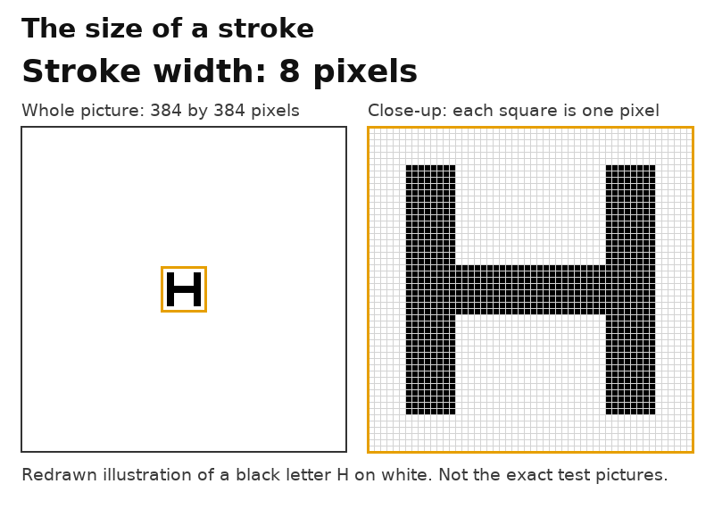
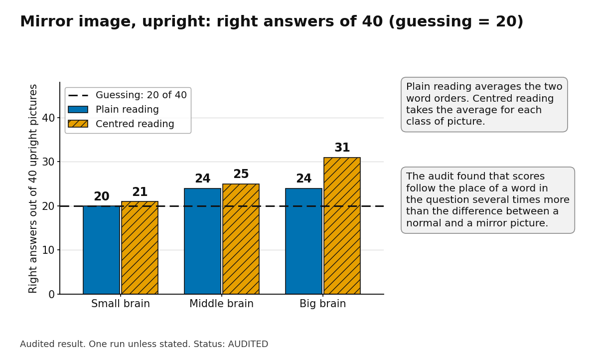
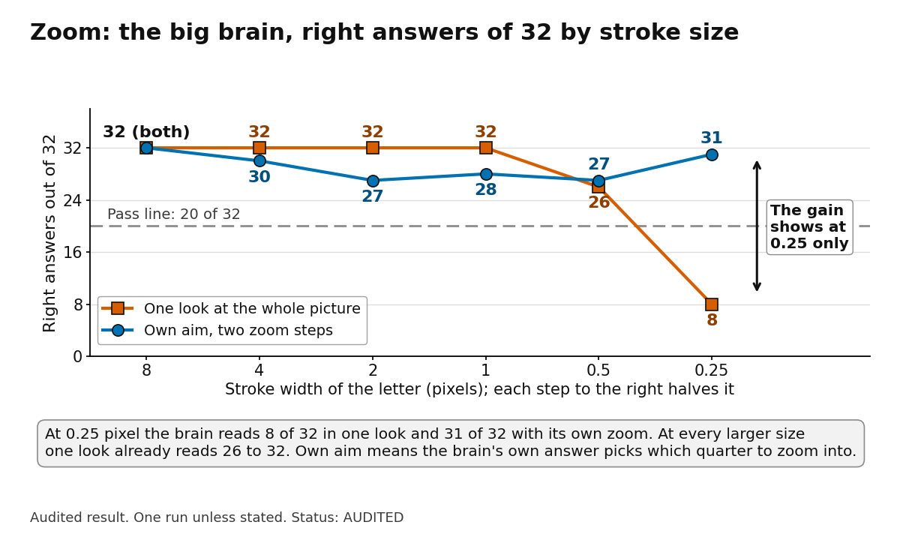

# 35. Eyesight, a second try: a repaired ring test, a mirror-image test and a zoom test

## What this is

Snapshot dated 12 November 2026. The three tests ran on 11 November 2026 and were audited the same day. They are the second try at eyesight after document 33. Document 33 first listed the zoom and mirror-image tests as in progress and said the repaired ring test had not run. It now carries a short note on each; this document gives the full account.

The "small", "middle" and "big" brains are the frozen 0.8B, 2B and 4B language models of one public family. Each has a small picture part. All pictures are generated by a program. No person took any of the tests.

Every test had a written rule with fixed bars. Each rule was registered with a checksum and a time before its run. An independent AI audit then recomputed the numbers from the raw answers. The audit drew the pictures again and tried to break each sentence built on a result. Only audited results are reported here. Where an audit took a claim back, we say so and give the reason.

**Labels.** **FACT (audited)** means we measured it and an audit recomputed it. **GUESS** means our reasoning, not tested. **INFERENCE** means a conclusion drawn from audited facts. It was not tested directly.

**Audit verdict words**, as the audit notes use them: CONFIRMED, CONFIRMED-WITH-CAVEATS and NOT-CONFIRMED. They judge a sentence, not a test. The rules' own test labels, such as MIRROR-BLIND, BETWEEN and ZOOM-FULL-GAIN, name outcomes under the rules. They are not claims about the eye.

## The three tests in plain words

These are definitions, not results.

- **Ring test (ACUITY-2, repaired).** A Landolt ring is a circle with a gap. The question is which side the gap is on: top, bottom, left or right. The ring gets smaller over 12 sizes.
- **Letter test (ACUITY-2).** One black letter (H, O, T or V) alone in a white picture of 384 by 384 pixels. The brain names the letter. A stroke of one pixel is one dot of the picture.
- **Eye-chart line.** A published clinical reference gives one minute of arc as the normal-sight line for the thinnest stroke. The audits read this reference second-hand and did not open it again. It is a definition, not a measure of people.
- **Mirror-image test (MIRROR-1).** A character and its left-right reversed copy. The five characters are R, F, 5, 2 and 4. Each is shown upright, or turned on the screen by 60, 120, 180, 240 or 300 degrees. The brain is asked in words: is this the normal character or its mirror image?
- **Zoom test (ZOOM-1).** A picture of 384 by 384 pixels with one black letter (H, O, T or V) on white. A zoom is a new, closer look at one quarter, drawn at double size. Two steps give four times the size; four steps give sixteen. In TOLD arms the right quarter is given. In SELF arms the brain's own answer picks it. ONE LOOK means the whole picture, once. RANDOM is a blank white picture, as a control.

*Figure 35.1.* A redrawn illustration, not the exact test pictures: a black letter H on a plain white picture of 384 by 384 pixels at stroke widths of 8, 4, 2, 1 and 0.5 pixels, with a close-up in which each square is one pixel. The letter shape, its height of five stroke widths and its placement on a pixel corner are drawn for illustration only.

## Summary

**FACT (audited).** The table lists each result in this document.

| Test | What we asked | What the audit says | Status and how far to trust it |
|---|---|---|---|
| ACUITY-2, letters | Which of four letters, at 12 sizes? | Numbers reproduce. Middle and big brain name every letter down to strokes of 0.75 pixel. The small brain mixes up T and V at three sizes | Audited, CONFIRMED-WITH-CAVEATS. "The limit is the picture" NOT-CONFIRMED |
| ACUITY-2, ring | Which side has the gap? | Numbers reproduce. Answers go by the place of a word in the question | Audited. "Cannot tell which way" NOT-CONFIRMED as worded |
| MIRROR-1 | Normal or mirror image, upright and turned? | Numbers reproduce. Upright: 20, 24 and 24 right of 40, where guessing gives 20 | Audited. "Cannot tell" NOT-CONFIRMED. Words MIRROR-BLIND (small and middle), BETWEEN (big) |
| ZOOM-1, one look | Which quarter, from one look? | Smallest passing stroke: 1, 0.5 and 0.5 pixel | Audited, as derived |
| ZOOM-1, big brain | Does a zoom help? | Two steps: ends on the letter in 169 of 192 tries. Four steps: 109 of 192, and its largest size failed | Audited. "Zoom works" and "loses its way" withdrawn |
| ZOOM-1, middle and small | Same | Entry check not passed. Verdict NOT-JUDGED | Audited; no zoom verdict |

## 1. Letters and rings: a repaired eyesight test (ACUITY-2)

### What changed from the first try

**FACT (audited).** The first ring test asked each question in two word orders. Those two orders were mirror images of each other. The repaired test asks each question in four word orders. Each answer then stands once in each place.

**FACT (audited).** The repaired test adds the letter test and a centred reading. The centred reading takes out each brain's average lean toward one answer before counting. There are 12 stroke sizes, from 32 down to 0.5 pixel, with 32 pictures of each kind at each size.

**FACT (audited).** A size passes when a brain names 20 or more of 32 right, at that size and at every larger size. 20 of 32 is a rate of 0.625. Guessing reaches 20 of 32 with a chance of 8 in a million, so a pass is not luck.

### Letters: results

**FACT (audited).** The middle and big brain named all 32 letters at every size down to 0.75 pixel. At 0.5 pixel each answered O for all 32 pictures.

**FACT (audited).** The small brain named 22 of 32 at 0.75 pixel and 21 of 32 at 4 pixels. It named H and O well at every size. Over the eleven sizes from 32 down to 0.75 pixel it scored H 86 of 88, O 88 of 88, T 70 of 88 and V 73 of 88. Its T was right at most sizes. At strokes of 4, 2 and 0.75 pixels it was right 1, 3 and 2 times of 8.

**FACT (audited).** All three brains have their threshold at 0.75 pixel. A count of 22 of 32 fits a true rate from 0.50 to 0.84. For the small brain two sizes sit on the line. One miss at 4 pixels would move its threshold to 6 pixels, eight times larger.

**INFERENCE.** For the small brain, the 0.75 threshold is fair only as a summary: it passes the line at every size down to 0.75, twice by one or two answers. It reads H and O at every size and loses T and V at three sizes.

### What the audit checked on the letter pictures

**FACT (audited).** No shortcut was found. Each size holds four different letter pictures. Each is placed at eight spots, and the four letters share the same spots.

**FACT (audited).** A rough reader that goes by total ink reaches at most 16 of 32. Telling H from O, or T from V, by ink alone needs a measure that is fine to 1 in 100. No rough reader reached 20 of 32.

**FACT (audited).** All letter centres sit on one corner of the pixel grid. For strokes of 1.5, 1 and 0.5 pixels that is among the worst of 64 spots tried. At the best spot, the same half-pixel picture holds four clear letters. The brains were never shown those.

**FACT (audited).** Nothing is taught in this test, and no answer is shown. A brain cannot learn during the test which pattern goes with which name.

### What the audit took back about letters

**FACT (audited).** "The limit is the picture, not the brain" was not confirmed. The half-pixel letters stood at almost the worst spot on the pixel grid. The test did not find where the brains' limit lies.

**FACT (audited).** "The limit is the same for the three brains" was reworded. At 0.75 pixel the scores are 22, 32 and 32 of 32. One size lower, the big brain alone stays above chance (20 of 32) once its O habit is taken out. The middle brain (10) and the small brain (8) do not.

**FACT (audited).** "Seven times coarser than normal sight" was not confirmed as worded. The 7 comes from a view we assumed for the 384 pixels. Spread over 60 degrees, a stroke of 0.75 pixel is 7.03 minutes of arc. The same arithmetic gives 3.52 at 30 degrees and 10.55 at 90 degrees. At 60 degrees a normal-sight letter would be about half a pixel tall. "Strong glasses" was not confirmed either: it suggests blur, and the limit here is the number of pixels.

**FACT (audited).** From the models' published layouts, the small brain's picture part has 12 layers of width 768. The middle brain's has 24 layers of width 1,024. The big brain's could not be checked. All three receive the same picture format. The registered word SAME-EYE only means three equal threshold numbers. It does not show a shared eye.

### The ring: results

**FACT (audited).** At the two largest rings, centred reading: the small brain 16 and 21 of 32, the middle brain 32 and 21, the big brain 31 and 26. Below those sizes the small and middle brain are near chance. The big brain stays at 17 to 19 of 32 at every gap from 12 down to 2 pixels.

**FACT (audited).** The answers follow the place of a word. In single askings the small brain names the first-offered word in 1,420 of 1,536 askings (92 in 100). The middle brain names the first-named word in 765 of 1,536, close to half. The big brain names the last-named word in 801 of 1,536. Averaged over four orders, the small brain says "left" 380 times of 384. That describes the average, not an answer it gave.

**FACT (audited, exploratory).** Read as two two-way questions, top or bottom and left or right, the big brain has the side right in 132 of 160 answers at gaps of 12 down to 3 pixels. A coin would give about half. This reading was chosen after the data were seen. It is not registered.

**INFERENCE.** The test does not show that the eyes miss the side. It shows that these brains do not name the side when the question is asked this way.

### Mirror-type errors in the ring

**FACT (audited).** A mirror-type error is an answer on the opposite side. By chance one error in three would go there. In the centred reading, at gaps of 12 to 2 pixels, 33 of 137 small-brain errors, 28 of 118 middle-brain errors and 31 of 81 big-brain errors went there. At the two largest rings, the big brain's 7 of 7 errors did. A simpler habit for "top" explains most of that.

**INFERENCE.** The ring data do not link ring errors to mirror images.

## 2. Mirror-image test (MIRROR-1)

### What we asked

**FACT (audited).** Each brain saw 240 pictures. They cover five characters, two versions (normal and mirror), six angles and four positions on the picture. Upright there are 40 pictures. The four positions are the same for both versions. So the 40 upright pictures are 10 drawings, each in four places.

**FACT (audited).** The question was asked in words, in two word orders: "normal" first and "mirror" first. The registered choice averages the two. Our pictures are black bold letters on white, filling about half the picture. The published study used white characters on black.

**FACT (audited).** The rules set two readings. The plain reading averages the two word orders. The centred reading takes the average for each class of picture. A brain is MIRROR-BLIND only if both readings say so.

### Upright results

**FACT (audited).** Plain reading, upright. Guessing gives 20 of 40. The small brain got 20 of 40 right (interval 0.35 to 0.65). The middle brain got 24 of 40 (interval 0.45 to 0.74). The big brain got 24 of 40. Small and middle: MIRROR-BLIND. Big: MIRROR-BLIND on the plain reading.

**FACT (audited).** Centred reading, upright: small 21, middle 25 and big 31 of 40. The big brain's 31 of 40 has the interval 0.625 to 0.877. By the registered rule its word is BETWEEN.

*Figure 35.2.* Right answers out of 40 upright pictures of a character or its mirror image, for the small, middle and big models (status AUDITED). Plain reading: 20, 24 and 24; centred reading: 21, 25 and 31; guessing gives 20. An exploratory analysis in the same audit found that the place of a word in the question moves the score about three to eight times as much as reversal does. No person took this test.

**FACT (audited, exploratory).** When the centring is done inside each character, the upright counts are 30, 33 and 37 of 40. Each would be BETWEEN. So the word depends on how the centring is done.

### Upright twins (exploratory)

A twin is the same character, at the same place and angle, once normal and once mirror. The two pictures differ only by the left-right exchange, and for R by its position.

**FACT (audited, exploratory).** For upright twins, the normal picture scored higher for "normal" in 16 of 20 pairs (small), 18 of 20 (middle) and 20 of 20 (big). Guessing gives half. The chance of a count this lopsided is 0.012, 0.0004 and 0.000002. Without R, the counts are 13, 15 and 16 of 16.

**FACT (audited, exploratory).** The difference is small. The mean probability of "normal" for upright normal pictures against upright mirror pictures is 0.635 against 0.601 (small), 0.639 against 0.592 (middle) and 0.633 against 0.536 (big).

**FACT (audited, exploratory).** A made-up responder says "normal" for upright pictures and "mirror" for turned ones. It has no sight of reversal at all. It scores 20 of 40 upright. The big brain gives that responder's answer in 230 of 240 pictures. The small brain does so in 195 and the middle brain in 193. Most of the score follows upright or turned, not reversal.

**FACT (audited, exploratory).** Upside down, the big brain's normal twin scored higher in only 3 of 20 pairs (chance 0.003). Across upright and upside-down twins together, its score follows left and right as they lie in the picture, in 37 of 40 twins.

**GUESS.** The big brain may follow left and right in the frame of the picture, without turning the character back in its mind. The data cannot separate that from other causes.

**FACT (audited, exploratory).** All three brains see the tilt: upright against tilted moves the score by 0.8 to 1.0. Turned pictures, read plainly, are at about guessing level for all three. The big brain's centred count at 180 degrees is 13 of 40, with the interval 0.20 to 0.48.

### Single askings and the word that comes first

**FACT (audited).** In single askings the brains name the word offered first. Of 480 single askings, the small brain did so 409 times (85 in 100), the middle brain 473 times (99) and the big brain 415 times (86). Their right answers in single askings were 241, 247 and 245 of 480, about half.

**FACT (audited, exploratory).** Of the movement in the scores, the place of the word makes up 52, 83 and 68 percent. Reversal (normal or mirror) makes up 0.06, 0.12 and 0.00 percent. Upright, the place of the word moves the score about three to eight times as much as reversal does.

### The people's numbers, at the source

**FACT (audited at the source).** Quan and colleagues, PLOS ONE, 2017, a study of the late phase of mental rotation. Of 27 volunteers, 22 were analysed. All were men and postgraduates. They practised until a block reached 90 percent. Only those above an accuracy line were kept: a mean of at least 85 percent, and at least 65 percent in each kind of trial. Each answered by key press within 4 seconds.

**FACT (audited at the source).** Right in 100, normal and then mirror: upright 99.2 and 97.9. Upside down 95.3 and 85.7. "About 90" hides the gap between them. The fair words are 95 and 86. The people were practised and pressed keys. The brains had no practice, answered in words, and saw our drawings. So this is not the same test (INFERENCE).

### What the audit took back (mirror)

- The heading "the brains cannot tell a letter from its mirror image, even upright" was not confirmed. The scores show a small, steady difference between normal and mirror upright pictures in all three brains. The difference is several times weaker than the pull of the word's place.
- "Cannot tell" was withdrawn. MIRROR-BLIND means that the difference does not decide the answer. It does not mean the difference is absent. A made-up brain that tells the two apart by as little as these brains do gets the same word in 150 to 191 of 200 tries.
- "The same weakness" as in the picture memory and the ring was withdrawn. The audit found no support for that link.
- "We gave our three brains the same pictures" was withdrawn. The pictures are our own drawings.
- "The question was understood as a two-way choice" was withdrawn. The brains followed the answer form. Their answers go by the place of the word.
- "The eye does not hand the brain left and right reliably" was not confirmed. The test reads the answer, which comes after the eye, the brain and the question have all had their say. It cannot place the loss.
- The R was drawn about 19.5 pixels right of centre. A normal R sits 19 pixels to the right of its mirror twin. The counts without R stand.
- "Anything that needs left and right will meet it" was not confirmed. It was not tested.

**Allowed sentence (audit).** Asked in words whether an upright character is the normal one or its mirror image, none of the three brains answers by what the picture shows. Where the loss sits, in the eye, in the brain or in the asking, this test cannot say. Its scores speak against an eye that is blind to the difference.

## 3. Zoom test (ZOOM-1)

### What we asked

**FACT (audited).** Does a zoom let a brain read a letter it cannot read in one look? The one-look arm offers eight stroke sizes, from 8 pixels down to 0.0625 pixel. The two-step arm offers six sizes, from 8 down to 0.25 pixel. The four-step arm offers six sizes, from 2 down to 0.0625 pixel.

**FACT (audited).** The brain's answer is the higher of its word scores after the fixed word "Answer:", with four word orders. The program runs the chain. The brain does not decide how far to zoom or when to stop.

### One look and the control

**FACT (audited).** The smallest stroke that passes in one look is 1 pixel for the small brain and 0.5 pixel for the middle and big brains. RANDOM is a blank white picture. Every brain answers O for it, 8 of 32 at every size. That 8 is the O habit, not a coin.

### The counts

**FACT (audited).** Counts of right answers out of 32. Columns are stroke sizes in pixels.

| Brain and look | 8 | 4 | 2 | 1 | 0.5 | 0.25 |
|---|---|---|---|---|---|---|
| Small, one look | 26 | 23 | 26 | 25 | 10 | 8 |
| Small, told, two steps | 32 | 32 | 29 | 26 | 28 | 26 |
| Small, own aim, two steps | 16 | 14 | 10 | 15 | 18 | 12 |
| Middle, one look | 32 | 31 | 32 | 32 | 24 | 8 |
| Middle, told, two steps | 31 | 32 | 32 | 31 | 32 | 32 |
| Middle, own aim, two steps | 23 | 31 | 30 | 31 | 29 | 20 |
| Big, one look | 32 | 32 | 32 | 32 | 26 | 8 |
| Big, told, two steps | 32 | 32 | 32 | 32 | 32 | 32 |
| Big, own aim, two steps | 32 | 30 | 27 | 28 | 27 | 31 |

**FACT (audited).** Four-step arm, columns are strokes of 2, 1, 0.5, 0.25, 0.125 and 0.0625 pixel. Small, told: 32, 32, 29, 21, 32, 28. Small, own aim: 10, 8, 10, 8, 8, 8. Middle, told: 32 at all six sizes. Middle, own aim: 18, 25, 17, 17, 13, 12. Big, told: 32 at all six sizes. Big, own aim: 19, 29, 22, 23, 20, 16.

### What a zoomed look is

**FACT (audited).** A zoomed look is drawn again from the picture at the new size. It is not an enlargement of the first look, so it is as sharp as a large letter in a first look. Where the first look holds no ink, the zoomed look holds a clean O. The first looks at the smallest sizes hold little: a grey smudge of two pixels at 0.25 pixel, one or two faint pixels at 0.125, and one faint pixel at 0.0625.

**FACT (audited).** The words "8 times" and "16 times" come from the list of sizes. The factor is the one-look threshold divided by the smallest size offered: 0.5 divided by 0.0625 is 8, and 1 divided by 0.0625 is 16. A longer list would give a larger factor. Where the gain stops was not asked.

### The big brain: two steps (ZOOM-FULL-GAIN)

**FACT (audited).** Over two steps the big brain's own aim ends on the letter in 169 of 192 tries. Its one-look threshold is 0.5 pixel. Its zoomed threshold is 0.25 pixel, half the one-look size. That is the most this arm could show, because 0.25 was its smallest size.

**FACT (audited).** The gain shows at one size only. At 0.25 pixel the brain reads 8 of 32 in one look and 31 of 32 with its own zoom. At the five larger sizes one look already reads 26 to 32 of 32. Its own zoom reads 27 to 32 on the same pictures.

*Figure 35.3.* Right answers out of 32 for the big model at six stroke widths, in one look at the whole picture and after two zoom steps where its own answer picks the quarter (status AUDITED). From 8 down to 0.5 pixel one look already scores 26 to 32 and its own zoom 27 to 32; at 0.25 pixel one look scores 8 and the zoom 31, so the gain shows at that one size only, and 0.25 was the smallest size offered. When the right quarter was given instead, the model scored 32 of 32 at every size.

### The big brain: four steps (ZOOM-NO-GAIN)

**FACT (audited).** Over four steps the big brain's chains end on the letter in 109 of 192 tries. The registered word is ZOOM-NO-GAIN. Its largest size, a stroke of 2 pixels, reached 19 of 32. That is below the pass line of 20. The brain reads that size in one look (32 of 32).

**FACT (audited).** Its steps get better, not worse. Both where-answers are right in 78, 82, 93 and 96 of 100 looks at steps 1 to 4. Of its 106 wrong where-answers, 94 say "top" for a letter in the bottom half. Left and right it is right in 943 of 957 looks.

**FACT (audited).** The "top" errors sit just under the middle line. For letters 0 to 16 pixels below the middle, it said top in 26 of 26 looks. For letters 48 to 64 pixels below, it said top in 1 of 40. By the audit's reading, its line between top and bottom lies about 35 pixels too low (INFERENCE). Of its 19 right answers at the largest size, four were lucky O answers.

### The middle and small brains

**FACT (audited).** The entry check asks for the quarter right on the first look at stroke 8. It needs 29 of 32. The small brain got 21 and the middle brain 27. Both words are WHERE-NOT-UNDERSTOOD, reported as NOT-JUDGED. The big brain got 32.

**FACT (audited).** Their scores hold the place. Over first looks at every size but the smallest, 352 pictures, left or right is right in 349 times for the small brain and 351 for the middle brain. Top or bottom is right in 342 and 351 times. At the smallest size it is not.

**FACT (audited).** Their wrong where-answers lean one way. The small brain made 321 wrong answers, 292 of them "left" for a letter on the right. The middle brain made 152, of which 73 said "left" and 86 said "top". None went the other way.

**FACT (audited, exploratory).** The lean matches the answer each brain gives to a blank picture. Measured against that blank answer, the first-look quarter is right 297 times for the small brain and 334 times for the middle brain, of 352. Without that correction it is right 189 and 285 times.

**INFERENCE.** For these two brains the lean is an answer habit, not a failure to see. This is not a registered result. The same kind of correction does not work for the big brain. Against its blank answer its quarter is right 324 of 352 times, against 328 plain.

**GUESS.** Teaching may remove the lean. Nothing has been taught yet.

## 4. What we got wrong, and how the audits caught it

- "The limit is the picture, not the brain" (ACUITY-2): not confirmed.
- "The limit is the same for the three brains": reworded (section 1).
- "Cannot tell which way a ring opens": withdrawn. "Does not say it when asked this way" stands.
- "So the brains see WHAT a small sign is, but not WHICH WAY it points": withdrawn.
- "The same weakness as with mirror images and turning shapes in the mind": withdrawn.
- The heading "cannot tell a letter from its mirror image, even upright": not confirmed.
- "The third time the same weakness shows": withdrawn.
- "We gave our three brains the same pictures": withdrawn.
- "The question was understood as a two-way choice": withdrawn.
- "None when turned" for the big brain: wrong at 180 degrees. Its upside-down scores go the wrong way in 17 of 20 pairs.
- "Zoom works" for all three brains: withdrawn. What is shown is that a letter drawn large is read.
- "Zoomed to the right place, letters read 8 to 16 times smaller": withdrawn as a claim about the brains. The factor comes from the size list.
- "Over four steps it loses its way": withdrawn. Its steps get better.
- "Missed the line at the largest size by a single answer": withdrawn.
- "The parts of an eye with zoom are there": not confirmed as worded.
- "It knows top from bottom every time": holds at the largest size only. Withdrawn.
- "Zoomed to a wrong place they score exactly what guessing gives": withdrawn. A blank picture gives O every time, which is the O habit, not a coin.
- "Should be teachable": may stay as an idea for later. It is not a finding.
- Document 33 first said the repaired ring test had not run, and that the zoom and mirror tests were in progress. It has been updated and points here.

**Process notes (FACT, audited).**

- Each test ran once. The rules and checksums were set before the runs, and the audits confirmed that order with caveats. The largest model's version was not pinned. No checksum of model weights was taken, and the checks cover the program and the pictures only.
- In the zoom test, an addendum was written 25 minutes into the run. No answer was on disk before the run ended, and the audit found no sign that any answer was read earlier. The run's live progress view could be watched while it ran. Whether it was watched cannot be shown either way.
- In the zoom test, one check's flag was widened in the checking program without an addendum. The audit recorded it. The change makes the flag fire more often, not less.

## What this does not show

**FACT (audited).** These tests used generated letters and rings on a white picture, one run each, and frozen models. They do not show that any eye or brain works this way. They do not show that any model sees at human level.

- No person took any test. Human numbers come from published studies with other pictures, other tasks and other people. The people in the mirror-image study were practised and were kept after an accuracy line.
- The mirror-image test uses five characters, and the letters stood at fixed spots on the pixel grid. The audit could not say what other characters or spots would give.
- The audits did not run any brain again. They recomputed the numbers from stored answers and drew the pictures again. Each audit was one pass by a separate AI reviewer. Nothing here has been peer reviewed.

## Open questions

Nothing in this section is a result. None of these tests has been registered or run.

**GUESS.** Letters at a better spot on the pixel grid, at the smallest sizes. This would show whether the small limit is the picture or the spot. Repeat runs of all three tests are also open, since each ran once.

**GUESS.** A two-way question with a visible answer, such as "is it the character R or the character F?" If the place habit also swamps that question, the question is at fault and no eye has been measured.

**GUESS.** For the mirror test: a yes-or-no form, options named A and B, eight worked examples with the right answers before the test, a same-or-different test with no words, and left and right without mirror images.

**GUESS.** A read-out on the picture part alone, for normal or mirror, fitted on three characters and tested on two new ones. If it works on new characters, the eye hands over handedness in a general form, and the loss comes later.

**GUESS.** For the zoom test: whether a correction for the blank-answer lean keeps a whole chain on the letter, a longer list of sizes, and the small brain's trouble with T at 4 pixels.

None of these tests has shown anything about real eyes, real brains or human-level sight.
