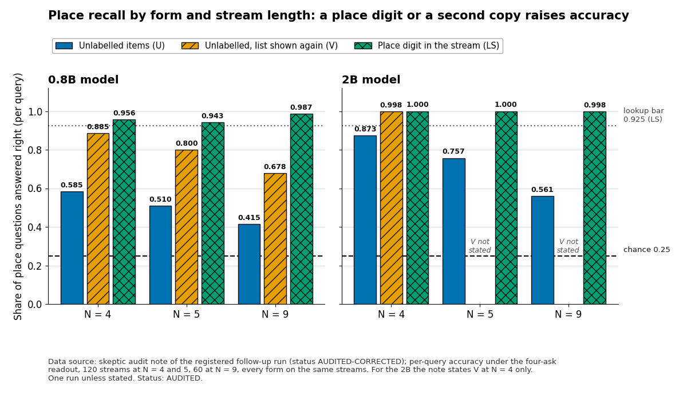

# 37. Labelled recall and the re-shown copy: a registered follow-up on place recall in a stream, and what the audit allows us to say

Version 1. Snapshot dated 12 November 2026. The run, its audit and the reveal of its secret seed took place on 12 November 2026.

## Abstract

Document 36 reported that two frozen language models, a 0.8B and a 2B, missed questions about which item sat at a named place when the items carried no labels. It could not say whether the miss lay in reaching a place or in holding the items. This document reports the registered follow-up on fresh streams of 4, 5 and 9 items: the same items once unlabelled (U), once with a place digit written into the stream (LS), and once with the list shown a second time right before the question (V), plus a control that swaps the stream for another one. The rules and the checksum of the secret master seed were logged before the streams existed, and an independent AI audit recomputed every number (no difference in 716 plus 216 comparisons). Unlabelled, the earlier misses replicated: the 0.8B got 8 of 120 whole trials right at four items and 0 of 120 at five, and the 2B got 66 of 120 (unresolved) and 21 of 120. With a place digit, per-query accuracy was 0.94 to 1.00; a shown-again copy raised it by 0.29 (0.8B) and 0.20 (2B at 5 items). The control passed for both models, so the document 36 verdicts are no longer provisional. The audit licenses one narrow reading: under this interface, one question wording and one alphabet, the shortfall is in reaching a place among unlabelled items, not in having the items. It licenses no memory claim, and neither the claim that counting is the whole limit nor its opposite. The main limits are one run, two models of one hybrid family, one wording, one alphabet and streams of 16 to 36 tokens.

## Introduction

### Why this follow-up

Document 36 ended with three open points. First, it had no labelled arm at 4 or 5 items, so it could not tell a failure to reach a place from a failure to hold the items. Second, a control that replaces the stream with another one (N-MISMATCH) had not run, so every verdict of that document was provisional. Third, the 0.8B had skipped its reader control. The audit of that run had also taken back the reading "the models do not remember".

This follow-up adds the three pieces that document 36 lacked: the same streams with and without a place label, a re-shown copy of the list, and the N-MISMATCH control, and it reruns the 0.8B reader control. It is a registered test with pass and kill lines written before the data existed.

### What was known and what we add

Known from document 36 (audited): unlabelled whole-trial counts were at or below the registered line at 4 and 5 items; labelled recall at 22 and 72 items was 98 to 99.5 percent per query. Known from document 32: the 2B kept the order of events better than the 0.8B. We add fresh streams for the unlabelled cells, a paired labelled form at the same lengths, a copy-sensitivity form, and the closing control.

### Terms

These are definitions, not results. Terms of document 36 (stream, place, trial, per query, full trial, four-ask readout, RAW, BARE) keep their meaning.

- **U, LS, LW, V.** Four forms of the same stream and the same question (Table 1).
- **Re-shown copy.** In form V, the list of items is shown a second time right before the question, in the same order, after a short introductory line.
- **N-MISMATCH.** A control in which the question and options of a stream are kept and the stream itself is replaced by another stream. A reader that uses the stream should then fall to chance (0.25 for four options).
- **Reader control (B1).** The item is shown alone, in one labelled block, with the same question. It checks that the model can read and match the item. It does not test counting.
- **Contrast.** The paired difference between two forms on the same streams.
- **PASS, KILL, UNCLEAR, UNGRADEABLE.** Outcome words under the registered rules, as in document 36. They are not claims about memory.
- **Labels.** As in documents 34 to 36: **FACT (audited)**, **INFERENCE**, **GUESS**, **DERIVED** (arithmetic on stated inputs). The audit's own status for the run is AUDITED-CORRECTED.

## Methods

### Models and items

**FACT (audited).** Two frozen models of one public family, Qwen3.5, with weights unchanged: the 0.8B in 32-bit floating point and the 2B with a 16-bit (bf16) body and a 32-bit output head. The numeric format therefore differs between the two and is a stated confound. Both have 24 layers, of which 18 are linear-attention layers and 6 are full-attention layers (read from their configuration files; see also document 24). Every statement is per model.

**FACT (audited).** Items are single tokens from a fixed alphabet of 144 pseudo-words. A stream is N items, with N = 4, 5 or 9. In the unlabelled form one item block is 4 tokens, so the streams are 16 to 36 tokens long. At this length the whole stream sits in the model's context in plain text; nothing is stored or forgotten in an ordinary sense.

### The question and the readout

**FACT (audited).** After the stream the model is asked for the item at place q, in the words "item number q in the list, counting from the first", with four options. As in document 36, the model is asked four times with the four options rotated, and the four answers are combined into one prediction. The registered readout takes each place question on its own. A single ask (RAW) is reported as a descriptive column.

Two scores are used. With $\mathcal{Q}$ the set of all (stream, place) questions, $\hat o(s,q)$ the prediction and $o^{*}(s,q)$ the right option:

$$a=\frac{1}{|\mathcal{Q}|}\sum_{(s,q)\in\mathcal{Q}}\mathbf{1}\big[\hat o(s,q)=o^{*}(s,q)\big],\qquad T=\frac{1}{S}\sum_{s=1}^{S}\prod_{q=1}^{N}\mathbf{1}\big[\hat o(s,q)=o^{*}(s,q)\big]$$

$a$ is per-query accuracy and $T$ is full-trial accuracy over $S$ streams. Guessing gives $a=0.25$. Under independent errors $T=a^{N}$, so a full-trial line of 0.50 corresponds to $a=0.5^{1/N}$, which is 0.841 at N = 4 and 0.871 at N = 5 (DERIVED, as in document 36).

### The four forms

**Table 1. The forms.** The same stream, items, options and answer slot are used in every form (FACT, audited; the pairing was checked token by token).

| Form | What is in the context | What differs from U |
|---|---|---|
| U | Item blocks with no label. | Reference form. |
| LS | The same blocks, each with its place digit written in (1 to 9). The question is word for word as in U. | Only the place digits. |
| LW | The labelled stream of LS, with a question that names the label string. Descriptive only. | Question wording. |
| V | The U stream, then a short introductory line, then all N blocks again in the same order, then the U question. | A start marker and a second copy, 12 + 4N extra tokens (28, 32 and 48 tokens at N = 4, 5 and 9). |

```text
U  block : "<<" + item + ">>" + newline
LS block : "<<" + place_digit + item + ">>" + newline
V  ask   : U stream, then "The same list again, in the same order:" + newline,
           then the N U-blocks again, then the U question
```

**FACT (audited).** Deleting the label digit tokens from every LS stream gives the U stream exactly (1,620 of 1,620 questions); the LS and U questions are token-identical; the V question is the U question plus the inserted segment.

### Streams and sizes

**FACT (audited).** There were 120 streams at N = 4, 120 at N = 5 and 60 at N = 9: 300 streams, 1,620 questions and 6,480 asks per form and model. Every form read the same streams. The streams came from a secret master seed made for this run (details below). The counts were chosen by a power simulation that used the per-query accuracies of document 36 (0.85 and 0.75 for the 2B, 0.60 for a weaker model, rounded). They set power only; no line or margin depends on them.

### Lines, statistics and the outcome rule

**FACT (audited).** The decision cells and their lines:

- **U at N = 4 and N = 5 (decision).** Full-trial accuracy against the line 0.50, with exact (Clopper-Pearson) bounds. With $k$ whole trials right of $n$, the one-sided lower bound at level $\alpha$ is $p_L=B^{-1}(\alpha;\,k,\,n-k+1)$ and the one-sided upper bound is $p_U=B^{-1}(1-\alpha;\,k+1,\,n-k)$, where $B^{-1}$ is the beta quantile function. PASS needs the 95 percent lower bound at or above 0.50 (70 of 120 or more). KILL needs the 99 percent upper bound below 0.50 (46 of 120 or fewer). Otherwise UNCLEAR. At 60 streams the counts are 37 and 20.
- **LS at N = 4 and N = 5 (decision, the lookup bar).** Per-query accuracy against $b=1-(1-0.25)\times0.10=0.925$, a 10 percent lapse on top of guessing. The 10 percent is a guess and the bar is not a human number. Bootstrap over streams (10,000 resamples), PASS when the lower 95 percent bound is at or above the bar.
- **N = 9, V and LW.** Descriptive.
- **Contrasts.** $C_1=a_{LS}-a_{U}$ and $C_2=a_{V}-a_{U}$, per-query accuracy pooled over questions, bootstrap over streams, 90 percent two-sided interval. A contrast counts if its interval excludes 0 and its size is at least the minimum detectable difference of 0.06 (a guess). $C_2$ is RESCUE if it counts and is positive, NO-RESCUE if its upper bound is below 0.06, and V-UNCLEAR otherwise.
- **Reading set.** The contrasts are read at the N where U is KILL: pooled over N = 4 and 5 if both are KILL, at one N alone if only that one is.
- **Outcome rows.** R2: some U cell KILL, LS PASS, $C_1$ counts, $C_2$ NO-RESCUE ("an unlabelled ordinal-addressing limit under one wording"). R3: as R2 but $C_2$ RESCUE ("COPY-SENSITIVE"). R5: $C_1$ does not count. R6: $C_1$ counts but LS is not PASS. R0: control or gate failure.

**Control and gates (FACT, audited).** N-MISMATCH passes when the pooled upper 95 percent bound of per-query accuracy is at most 0.30 and no cell's 99 percent bound is above 0.40 (chance plus 0.15). It was run on the fresh U streams (300 streams) and on the earlier run's streams (144 streams, 1,568 questions: its 60 streams each at N = 4 and 5 and 14 and 10 of its streams at N = 22 and 72), the latter to close document 36. The reader control B1 was rerun for the 0.8B on the earlier streams, because its control there was skipped. Gates before grading: a rerun of 400 asks of the earlier run (G-REPRO), a repeat check (G-REPEAT), a tie check (G-TIE), and G-FIRST, a gate for an optional arm (E) that asks for order without counting.

### Seeds and order of events

**FACT (audited).** The master seed was generated before the run by a command that wrote it only to a private file. Its SHA-256 was logged first. Then came the rules (registered with a checksum), the code, the scorer, the runner and the model interface, each logged before it ran, then a smoke run, then the generation of the streams, then the gates, then the model runs. Result files were logged before anything read them. The temporary copy of the seed on the machine that ran the generator was shredded when the generator finished. An independent checker for the generator was written by a second author, a separate AI agent that did not write the generator, the runner or the rules.

**FACT (audited).** After the audit the seed was revealed. Its hash equals the logged hash, and regenerating the main streams from it gave all 14 stream files byte for byte. This shows that the streams came from that seed. It cannot show that nobody saw the seed earlier. The rules promised a logged note saying that nobody had seen it; the audit did not find that note. An attestation was supplied after the fact, so the secrecy rests on the lab's statement (the audit did not read or search for the seed). The seed value is not published.

### What the lab knew before the run

**FACT (audited).** The lab knew the results of the earlier run. They shaped the choice of forms and the stream counts. The unlabelled cells at 4 and 5 items are the first fresh replication of those results; the rules say which numbers may be used as background only.

### The independent audit

**FACT (audited).** The audit ran on a CPU with no model. It wrote its own scorer from the rules text before it opened the engineer's code. It recomputed 716 values against the stored results and 216 values (192 numbers and 24 verdict words) against the run report, and found no difference. It rebuilt the token ids and the SHA-256 of all 105,984 asks (every ask of every arm and both models) from the stored streams and the pinned tokenizer; all matched the logged digests. It checked that 600 stream states per model started fresh, recomputed the control limits and the thresholds, and checked the truth of all 1,620 questions at slot level (0 errors). Its limits: the audit, the engineer and the checker follow one convention file written by the engineer, and the reviewer is from the same model family.

### Procedure points

**FACT (audited).** The audit lists these deviations. It judges that none changes a number.

- The code, regression, checker and dry-run steps ran after registration, although one rule section lists them before. The registered header says they come after, so the rules contradict themselves. Rules and lines were frozen before any code existed, and scorer, runner and interface were logged before any main stream existed and never changed.
- The first launch failed at once for a missing mode flag, before any model loaded; it was relaunched after a one-flag fix.
- The runner was changed by one line before the smoke run; its dry run reproduced the earlier output byte for byte.
- Two short reading notes were logged after the first model job, although the rules forbid more readings by then. They touch a file description and a hardware label in a cost note.
- One model run waited about 38 minutes for the single graphics card to be free. This changes wall-clock time only.
- G-FIRST failed (Table 2), so the optional arm E did not run, as the rules provide.
- Two rule-text slips: a bootstrap seed index named differently in two places (no effect), and "about 2N + 12" extra tokens for V where the measured value is 12 + 4N (the measured value binds).

The run took about 1.65 GPU hours in all (the audit's tally).

## Results

All numbers are from the audit's recomputation (status AUDITED-CORRECTED), one run per cell.

### 3.1 Gates

**Table 2. Gate outcomes.**

| Gate | What it checks | 2B | 0.8B | Outcome |
|---|---|---|---|---|
| G-REPRO | 400 asks of the earlier run through the new code | 400 of 400 digests equal; scores bit-identical (largest difference 0.0) | same | Passed |
| G-REPEAT | Same ask twice | 0 flips in 100 questions, for each of the four forms | same | Passed |
| G-TIE | Ties between options | 0 in 500 | 0 in 500 | Passed |
| G-FIRST | Ordering inside a nine-item list, "first" wording, 160 pilot questions (bar 0.90) | 82 of 160 = 0.5125 | 104 of 160 = 0.65 | FAILED for both, so arm E not run |

*Table 2.* Source: the audit note, section 1. In the single unrotated ask (RAW ask 0) both models answered "A" on all 160 questions. The gate tests ordering inside a nine-item list, not the wording of the question. It is a pilot gate, not a result.

### 3.2 Unlabelled place recall (U)

**FACT (audited).** The misses of document 36 replicate on fresh streams.

**Table 3. Unlabelled whole-trial cells (decision cells).**

| Model | N | Streams | Whole trials right | Estimate | Bounds | Verdict | Document 36, same cell |
|---|---|---|---|---|---|---|---|
| 0.8B | 4 | 120 | 8 | 0.067 | 95% lower 0.034; 99% upper 0.139 | KILL, -ITEM-PRIOR | 5 of 60 |
| 0.8B | 5 | 120 | 0 | 0.000 | 99% upper 0.038 | KILL, -ITEM-PRIOR | 1 of 60 |
| 2B | 4 | 120 | 66 | 0.550 | 95% lower 0.471; 99% upper 0.657 | UNCLEAR | 32 of 60 |
| 2B | 5 | 120 | 21 | 0.175 | 99% upper 0.270 | KILL | 14 of 60 |

*Table 3.* Whole trials with every place right, line 0.50. One run per cell; chance for a whole trial is far below the line. The bounds are one-sided exact bounds; we recomputed them from the counts and they match the audit's printed values (DERIVED). The suffix -ITEM-PRIOR is added by the rules when answers lean toward particular items regardless of the stream (permutation p below 0.01; 0.8B at N = 4 p = 0.0014, at N = 5 p = 0.0056; the 2B has none below 0.01). The original report omitted it. Source: the audit note, section 1 and section 5.

**FACT (audited).** The 2B at N = 4 sits on the line. The first 60 streams gave 40 right (a PASS by themselves) and the second 60 gave 26. The whole-trial score of the 2B is above the 0.8B in each unlabelled cell.

**FACT (audited).** Per-query accuracy (Table 4) is 0.873, 0.757 and 0.561 for the 2B and 0.585, 0.510 and 0.415 for the 0.8B at N = 4, 5 and 9. A single ask (RAW) is lower by 0.07 to 0.23 in the unlabelled cells; for example 0.640 against 0.873 for the 2B at N = 4.

### 3.3 With a place digit in the stream (LS) and with the list shown again (V)

**Table 4. Per-query accuracy by form.**

| Model | N | U | V (list shown again) | LS (place digit) | LS 95% lower bound (bar 0.925) | LS verdict |
|---|---|---|---|---|---|---|
| 0.8B | 4 | 0.585 | 0.885 | 0.956 | 0.9417 | PASS |
| 0.8B | 5 | 0.510 | 0.800 | 0.943 | 0.9283 | PASS (thin margin) |
| 0.8B | 9 | 0.415 | 0.678 | 0.987 | not stated | descriptive |
| 2B | 4 | 0.873 | 0.998 | 1.000 | not stated | PASS |
| 2B | 5 | 0.757 | not stated | 1.000 | not stated | PASS |
| 2B | 9 | 0.561 | not stated | 0.998 | not stated | descriptive |

*Table 4.* Per-query accuracy under the four-ask readout, 120 streams at N = 4 and 5 and 60 at N = 9 (one run; chance 0.25). "Not stated" means the audit note does not print the value. Source: the audit note, sections 1 and 4.



*Figure 37.1.* Per-query accuracy by form and stream length for the 0.8B and 2B models, bars from zero (status AUDITED, one run). The dashed line is chance (0.25) and the dotted line the lookup bar (0.925, defined for LS at N = 4 and 5). The 2B's V bar is stated in the audit note at N = 4 only, so the other two are left out. Data source: the audit note of the run, sections 1 and 4; the same numbers are in Table 4.

**FACT (audited).** With the same items in the same order and a place digit added, accuracy is 0.94 to 1.00. The 2B scores 1.000 at N = 4 and 5. The 0.8B scores 0.956 and 0.943, both with the lower bound above the bar of 0.925; its margin at N = 5 is thin (0.9283), and the audit's resampling of the 120 streams puts the lower bound under 0.925 in about 31 percent of redraws (4 percent at N = 4). That is descriptive, not registered. A redraw could turn the 0.8B row from R3 into R6.

**FACT (audited).** The 0.8B's labelled errors at N = 5 are 34, of which 30 name the next item (mostly place 4 answered with place 5). A descriptive fourth form, LW, gave the 0.8B 0.978 at N = 5 against 0.943 for LS; the audit reads this as sensitivity to the wording of the question.

### 3.4 Contrasts and the outcome row

**Table 5. Contrasts and the outcome row.**

| Model | Read at (the reading set) | $C_1$ = LS minus U | $C_2$ = V minus U | $C_2/C_1$ | Outcome row |
|---|---|---|---|---|---|
| 0.8B | N = 4 and 5 pooled (both U cells KILL) | +0.406 [0.384, 0.426] | +0.294 [0.272, 0.317] | 0.73 | R3, COPY-SENSITIVE |
| 2B | N = 5 alone (only U-5 is KILL) | +0.243 [0.220, 0.268] | +0.197 [0.172, 0.222] | 0.81 | R3, COPY-SENSITIVE |
| 2B, descriptive | N = 4 and 5 pooled | not stated | +0.165 | 0.86 | not used |

*Table 5.* Differences in per-query accuracy, 90 percent bootstrap intervals over streams, one run. A contrast counts when its interval excludes 0 and it is at least 0.06; all counting contrasts here are positive. Two contrasts per model are not corrected for multiple looks. Source: the audit note, section 1.

**FACT (audited).** Per N, the label gap $C_1$ is +0.127, +0.243 and +0.437 for the 2B and +0.371, +0.433 and +0.572 for the 0.8B at N = 4, 5 and 9. It grows with N in both models (descriptive).

**FACT (audited).** Showing the list again before the question recovers 73 percent of the label gap for the 0.8B and 81 to 86 percent for the 2B. It never reaches LS for the 0.8B (0.885, 0.800 and 0.678 against 0.956, 0.943 and 0.987), and it nearly does for the 2B at N = 4 (0.998 against 1.000). Of the unlabelled errors, V fixes 98, 81 and 82 percent for the 2B and 74, 62 and 49 percent for the 0.8B at N = 4, 5 and 9, and it breaks 1 to 6 percent of the 0.8B's right answers and no more than 0.7 percent of the 2B's. What remains in V for the 0.8B is mostly the next item: 52 of 55 errors at N = 4 and 107 of 120 at N = 5 are one place too late, and 44 of the 52 and 69 of the 107 pick the last item of the stream.

**FACT (audited).** In the unlabelled form the list is already the last thing before the question (no tokens in between). In V the second copy sits exactly where the U list sat. So V does not change the distance between list and question at these lengths. What V adds is a line that marks where the list starts, and a repeat.

### 3.5 The control and the reader check

**Table 6. N-MISMATCH and the reader control.**

| Set | Model | Pooled accuracy (chance 0.25) | 95% bound (limit 0.30) | Largest per-cell 99% bound (limit 0.40) | Verdict |
|---|---|---|---|---|---|
| Fresh U streams (300 streams) | 0.8B | 0.2623 | 0.2745 | 0.2950 | PASS |
| Fresh U streams (300 streams) | 2B | 0.2469 | 0.2608 | 0.3019 | PASS |
| Earlier run's streams (144 streams, 1,568 questions) | 0.8B | 0.2513 | 0.2669 | 0.3149 (largest over both models) | PASS |
| Earlier run's streams (144 streams, 1,568 questions) | 2B | 0.2513 | 0.2675 | 0.3149 (largest over both models) | PASS |

*Table 6.* N-MISMATCH: the stream is replaced by the next stream while the question and options are kept. Source: the audit note, section 1.

**FACT (audited).** The reader control B1 passes in all four cells of document 36 for both models. The values, in the order the audit lists the cells (the note gives no mapping to N): 1.0, 0.9833, 1.0 and 0.9995 for the 0.8B (rerun for this run) and 0.9833, 0.9833, 1.0 and 1.0 for the 2B (taken from the earlier run).

**FACT (audited).** When the stream is replaced, accuracy falls to chance for both models on both sets, with every bound far inside its limit. So the answer cannot be read off the question and the options alone. The control cannot see a leak smaller than chance plus 0.15 that sits in one cell. The control on the earlier streams is a control, not new counting evidence.

### 3.6 What shapes the errors

**FACT (audited), unlabelled.** The 2B's accuracy by place falls with the place number (Table 7). Place 1 is right 0.98 to 1.00. The nearest items are not best, so this is not a curve of forgetting with distance. The 2B's errors lie next to the true place (66, 71 and 35 percent at N = 4, 5 and 9, against 50, 40 and 23 percent for a random wrong pick), with a lean to the next item (27 against 13 at N = 4, and 71 against 33 at N = 5). The 0.8B shows a serial-position curve, good at the two ends and near chance in the middle, and its errors are not nearer the true place than a random pick.

**Table 7. Unlabelled per-query accuracy by place.**

| Model, N | 1 | 2 | 3 | 4 | 5 | 6 | 7 | 8 | 9 |
|---|---|---|---|---|---|---|---|---|---|
| 2B, N = 4 | 0.98 | 0.92 | 0.83 | 0.77 | | | | | |
| 2B, N = 5 | 1.00 | 0.93 | 0.78 | 0.49 | 0.58 | | | | |
| 0.8B, N = 4 | 0.90 | 0.55 | 0.23 | 0.67 | | | | | |
| 0.8B, N = 5 | 0.95 | 0.60 | 0.32 | 0.21 | 0.48 | | | | |
| 0.8B, N = 9 | 0.98 | 0.80 | 0.48 | 0.25 | 0.20 | 0.17 | 0.28 | 0.17 | 0.40 |

*Table 7.* Source: the audit note, section 4 (one run). At N = 9 the 2B falls from 0.98 at place 1 to 0.23, at chance, at its lowest place; the note prints only those two values. The 2B pattern is the same shape as in document 36, Table 3.

**FACT (audited), priors.** The four-ask rotation cancels a lean toward an answer letter but not a lean toward the first or last item of the stream. The 0.8B names the first item in 41.7, 37.8 and 24.8 percent of unlabelled questions at N = 4, 5 and 9, where 25, 20 and 11 percent are asked. In V it leans to the last item (34 and 32 percent against 25 and 20). Accuracy still depends on the asked place (at N = 4, 0.90 when place 1 is asked and 0.23 when place 3 is, Table 7), so a lean does not explain the part above chance, but it shapes the errors. The 2B shows no such lean in V and LS. Item priors: the 0.8B's cells N = 4, 5 and 9 (U) and N = 9 (V) have p below 0.01; none of the 2B's does.

### 3.7 Effect on document 36

**Table 8. What changes for the claims of document 36.**

| Statement in document 36 | After this run |
|---|---|
| The unlabelled misses at 4 and 5 items | Replicated on fresh streams (Table 3). |
| No labelled arm at N = 4 or 5 | Now present: 0.94 to 1.00 per query (Table 4). |
| Every span verdict is provisional until N-MISMATCH runs | The control passes for both models (Table 6); the verdicts read "on the unlabelled ordinal interface". |
| The 0.8B reader control was skipped | Rerun; all four cells PASS (Table 6). |
| "The unlabelled result is a counting result" (INFERENCE) | Narrowed to "operational ordinal addressing under one wording". Counting as an operation is not shown, and the re-shown copy adds a start marker. |
| No counting-only control | Still none. V is not one. |
| A memory limit | Still not supported. At 16 to 36 tokens there is no memory to limit; LS PASS is the in-context lookup bar. |

*Table 8.* Source: the audit note, sections 4 and 6, and document 36.

### 3.8 Exploratory, unregistered, not a result

> **Exploratory, unregistered, not a result.** After the audit, a re-reading of the stored scores with another decode suggested that the scores of a stream hold more order information than the registered per-place readout shows. The registered readout takes each place's answer on its own; the alternative forces the answers for one stream to be a permutation, so each item is used once. This reading was not registered and has not been audited, so no number from it is given here, it replaces nothing above, and every registered number and verdict of this document stands. It changes one thing, the wording: the limit below holds for the registered per-place readout. The lesson we draw is to register the decode before a run and to report a decode-free ceiling next to every readout. A registered follow-up will test the decode properly.

### 3.9 What the audit corrected in the run's own report

**FACT (audited).** The audit confirmed the arithmetic and corrected the words and omissions of the lab's first report.

- The sentence "counting is not the whole limit" was taken back. It needs V to leave the counting demand unchanged, and V adds a start marker, which is itself a counting aid.
- The -ITEM-PRIOR suffix was missing for the 0.8B's cells at N = 4 and 5 (Table 3).
- For the 2B the report printed pooled contrasts, while the decision used N = 5 alone (Table 5).
- The report was silent that arm E did not run (G-FIRST failed), on the share $C_2/C_1$, on where the earlier-set reader control came from, on the procedure points above and on the thin 0.8B margin.

## Discussion

### What the data say

**Allowed statements (audit).** Per model (0.8B in 32-bit, 2B with a 16-bit body), one alphabet, N = 4, 5 and 9, one question wording, the four-ask readout, the stream in context as plain text, and under this interface only; each reads "indicated", not "shown":

1. The misses of document 36 replicate on fresh streams: the 0.8B is KILL at N = 4 (8 of 120) and N = 5 (0 of 120); the 2B is KILL at N = 5 (21 of 120) and on the line at N = 4 (66 of 120, unresolved).
2. With the same items and a place digit in the stream, accuracy is 0.94 to 1.00. The shortfall is therefore in reaching a place among unlabelled items, not in having the items: an unlabelled ordinal-addressing limit under one question wording and under the registered per-place readout (INFERENCE; the audit's own wording has no readout clause: we added 'under the registered per-place readout' because of the exploratory reading in section 3.8, which only narrows the statement).
3. A second copy of the list right before the question raises accuracy by 0.29 (0.8B, pooled over N = 4 and 5) and 0.20 (2B, N = 5) and closes most of the label gap: copy-sensitive. The introductory line and the repeat are not separated.
4. The control passes on both sets for both models, so the verdicts of document 36 read "on the unlabelled ordinal interface".
5. The label gap grows with N (descriptive).

### What the data do not say

- **Not a memory limit**, and not "the models do not remember". At 16 to 36 tokens of context there is no memory to limit. The labelled PASS is the in-context lookup bar.
- **Not "counting is not the whole limit", and not the opposite.** The re-shown copy adds a start marker, which is itself a counting aid. "Counting" is used only in the operational sense; position encoding, attention and the linear-attention state were not tested as mechanisms.
- **Nothing about both models together**, other families, non-hybrid models, other alphabets or real words, N above 9 on new streams, a 4B model, order without counting (arm E did not run), or a second question wording.
- **No human comparison.** The 0.925 bar is not a human number.
- **No firm R3 for the 0.8B** (thin margin at N = 5), and not "the 2B fails at N = 4" (unclear).

### Alternative explanations

**GUESS.** The audit leaves these open and each could produce part of the result: a lean toward the first or last item (0.8B); item priors (0.8B); the hybrid design (three of four layers keep a compressed state; whether that matters for place addressing is untested); one wording ("LS against LW" shows wording sensitivity); one alphabet and one family; two numeric formats; the four-ask readout (a single ask is lower by 0.07 to 0.23); the fact that the label gives the question a word to match ("number 3" with "<<3"), so LS measures lookup by a spelled-out index; and the per-place readout (box, section 3.8). The two models also fail in different ways: the 2B's errors cluster next to the true place, the 0.8B's do not.

### Scale

**INFERENCE.** The 2B is above the 0.8B in every unlabelled cell (66 and 21 of 120 against 8 and 0), consistent with document 32. With two sizes, two numeric formats and one family this is a description, not a scaling statement. A 4B model was not run.

## Limitations and threats to validity

- **Scale and family.** Two small models of one hybrid family; nothing here says anything about other families or larger models.
- **One run.** Each cell ran once; there is no repeat. The 2B at N = 4 is on the line (first 60 streams 40, second 60 streams 26). The 0.8B's labelled row at N = 5 is thin.
- **Stream length.** Streams are 16 to 36 tokens, so recall over longer spans is untested.
- **One wording, one alphabet.** 144 pseudo-words and one question wording. The audit sees wording sensitivity (LS against LW).
- **The re-shown copy is not a clean distance control.** It adds a start marker and a repeat. The intro line and the repeat are not separated.
- **Readout.** Registered per-place readout with a four-ask rotation. An unregistered, unaudited decode (box, section 3.8) suggests that a different decode may change the picture.
- **Numeric format.** The 0.8B ran in 32-bit and the 2B with a 16-bit body.
- **Design known to the lab.** The earlier results were known when this run was designed; stream counts were chosen with them in view.
- **Secrecy of the seed.** Rests on the lab's after-the-fact attestation (see Methods).
- **Process points.** Listed in Methods; none changes a number.
- **Independence.** The audit, the engineer and the checker follow one convention file; the reviewer is an AI pass of the same family. Nothing here has been peer reviewed.
- **Human comparison.** None is made.

## Reproducibility and data availability

**What is shared.** The forms and their templates, the scoring definitions, the lines, the exact-bound formulas, the contrast and outcome rules, the control definition, the gate outcomes, every audited number of the tables, and the audit's method.

**What is not shared.** The stream contents, the alphabet file, the run's code, the model weights, the seed value and the machine details. The seed was revealed after the audit and the streams were regenerated byte for byte from it, but the value stays private.

**What a reader can check now.** The arithmetic of Table 3: 8 of 120 is 0.067 and 66 of 120 is 0.55. The thresholds follow from exact binomial bounds: 70 of 120 gives a one-sided 95 percent lower bound at or above 0.50, and 46 of 120 or fewer gives a one-sided 99 percent upper bound below it (37 and 20 of 60). The bounds of Table 3 can be recomputed from the counts with the beta formula above. The bar is $1-(1-0.25)\times 0.10=0.925$.

A reader cannot yet rerun the test exactly, because the generator, the rule file and the question templates beyond Table 1 are internal. One run took about 1.65 GPU hours.

## Conclusion and open questions

**Measured (audited).** The unlabelled misses of document 36 replicate on fresh streams. With a place digit in the stream the same items are answered at 0.94 to 1.00, and a second copy of the list before the question raises accuracy by 0.20 to 0.29. The stream-swap control passes, so the earlier verdicts are no longer provisional. The audit took back the sentence that counting is not the whole limit.

**Allowed reading.** Under this interface, in this family, with one wording and one alphabet, the miss is in reaching a place among unlabelled items. Nothing here is a memory result.

**Guessed.** Splitting the re-shown copy into a start marker alone and a repeat alone would separate the two. A second wording, an alphabet of real words and a model without linear-attention layers would test how much of this is the interface. A gate on two-item streams would make the order-without-counting arm runnable. Registering the decode before the run, and reporting a decode-free ceiling beside it, would show how much of the miss is the readout. Letting the model write its own labels while it reads would test whether labelling can live inside the model.

## References

1. Internal audit note on the ORDER-2c run, skeptic audit, 12 November 2026, status AUDITED-CORRECTED. Not published. Every audited number in this document comes from it.
2. Internal result note on the same run, 12 November 2026, with the audit's licensed wording. Not published.
3. Internal rule file of the run (registered with a checksum before the streams existed; the Methods section follows its draft and the audit's confirmation that every threshold equals the registered text). Not published.
4. Document 36 in this repository, "Order and memory over a stream: a registered test, the gates that failed, and what the audit allows us to say". The earlier run (ORDER-2b).
5. Documents 32, 34 and 35 in this repository. Document 32 for the 2B against the 0.8B on event order; documents 34 and 35 for the audit practice and the form of the rules.
6. Document 24 in this repository, "Qwen3.5 from the inside", for the layer layout of the 0.8B.
7. Clopper, C. J. and Pearson, E. S. (1934). The use of confidence or fiducial limits illustrated in the case of the binomial. Biometrika 26(4), 404-413. https://doi.org/10.1093/biomet/26.4.404 (second-hand, not opened by us).
8. Efron, B. (1979). Bootstrap methods: another look at the jackknife. Annals of Statistics 7(1), 1-26. https://doi.org/10.1214/aos/1176344552 (second-hand, not opened by us).

The audit note names no published human reference, so none is cited.
